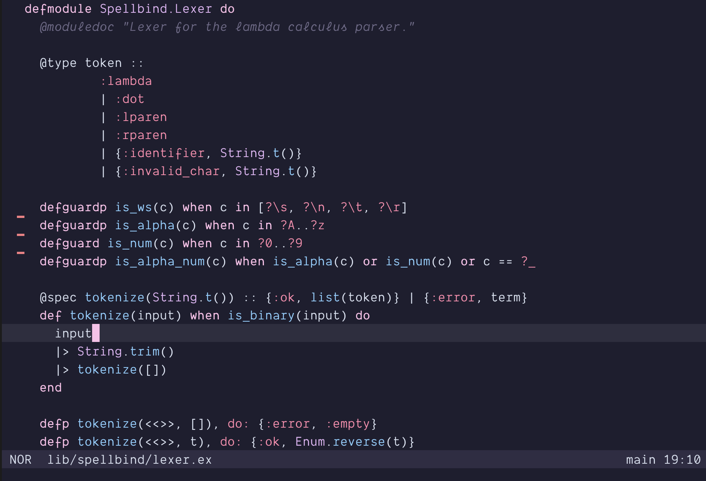
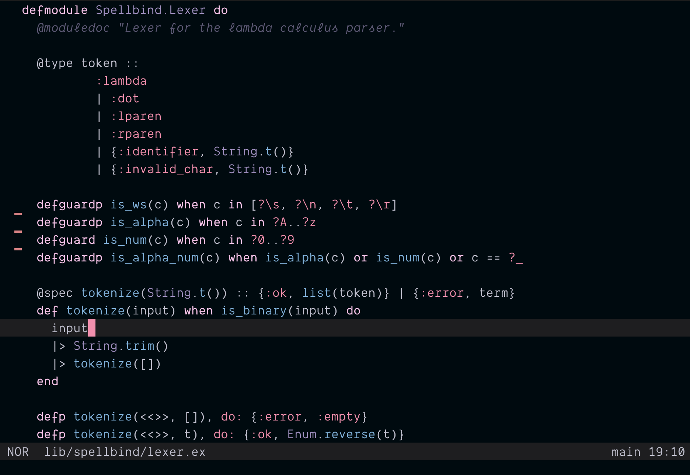
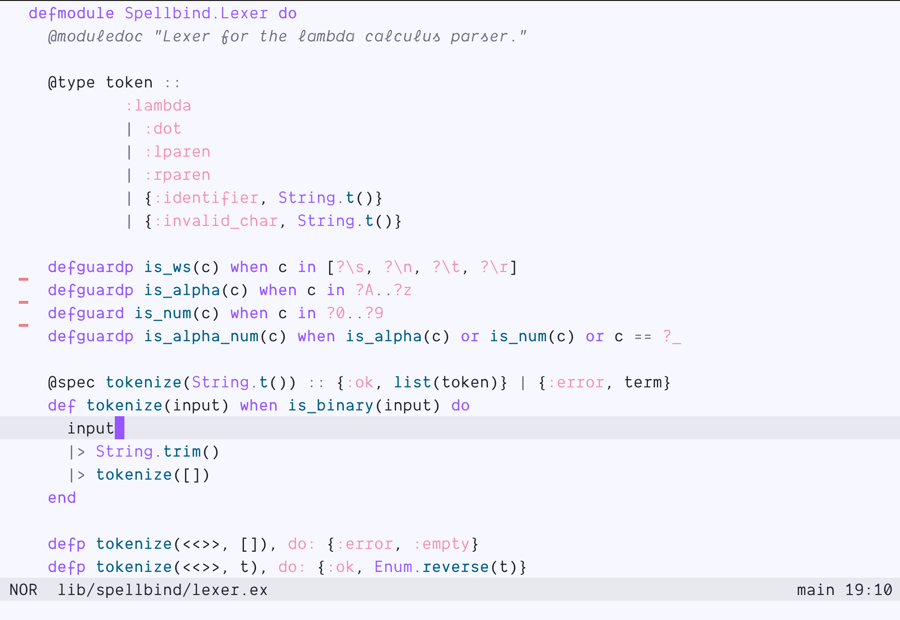

# nyxvamp (helix)

a minimalist theme collection, inspired by a blend of gothic and emo aesthetics with transfem symbolism. it combines deep purples and soft pinks with neutral tones to create strong contrasts and a comfortable coding environment that reflects individuality.

## variations

1. **veil**: versatile theme for both day and night, featuring bright accents on a dark background.

2. **obsidian**: dark theme for focused nighttime coding sessions.

3. **radiance**: light theme optimized for daylight use, ensuring excellent readability.

4. **jhujuba**: pink-tinted mid-dark theme, sweeter than veil.

5. **transparent**: override variant on top of veil, fully transparent background for compositors and terminal transparency.

## usage

1. downloads files
 - `nyxvamp-veil.toml`
 - `nyxvamp-obsidian.toml`
 - `nyxvamp-radiance.toml`
 - `nyxvamp-jhujuba.toml`
 - `nyxvamp-transparent.toml`
2. place into the helix themes directory
 - unix: `~/.config/helix/themes/`
 - windows: `%AppData%\helix\themes\` - you dare it?
3. issue the theme
 - open helix
 - start the cmd palette
 - type `nyxvamp-${variant}` where `${variant}` is one of veil, obsidian, radiance, jhujuba or transparent

## contribution

if you have suggestions or improvements, feel free to contribute or reach out.
